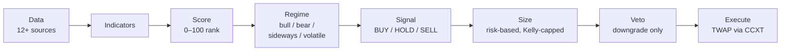

# Elite Swing Trader

Software I designed and built on my own that trades cryptocurrency automatically. It
gathers market information, decides what to buy and sell and how much, places the orders
on a real exchange, and keeps watch over everything it holds.

## Executive summary

- **What it does.** Every hour it collects prices and market data from more than a dozen
  sources, scores each coin, and decides whether to buy, hold or sell. It then sizes each
  trade so that no single loss can do much damage, and places the order on Coinbase
  in small pieces to get a fair price. It watches open positions around the clock and
  sends email and phone alerts when something needs attention.
- **How big it is.** About 47,000 lines of Python code, plus about 20,000 lines of
  automated tests (1,250 tests) that check it works correctly. I built it over seven
  months (March–October 2026) in 290+ saved versions.
- **How it did with real money.** It made 85 real trades across 31 different coins between
  March and June 2026. Everything worked mechanically: orders went through, positions were
  tracked, and losses were cut automatically. Financially it **lost a little**: the
  average trade lost 2.2%, and about half of that was exchange fees. I kept the amounts
  small on purpose while proving the system out.
- **What I did about it.** Instead of tweaking the strategy until the past results looked
  good — an easy way to fool yourself — I switched off real-money trading and built a
  stricter testing process. Every new strategy idea has to pass tests whose pass/fail rules
  are written down *before* the test runs. Eleven ideas have been tested this way; none
  has passed yet, so none is trading real money.
- **Where it stands today.** Running in practice mode: it makes simulated trades (435 so
  far) with no money at risk. Real-money trading is off and can only be turned back on
  deliberately.

> **In trading terms:** a deterministic pipeline (data → indicators → score → regime →
> signal → size → veto → execute) behind a Flask dashboard, executing via CCXT with TWAP
> orders, risk-based position sizing and a pre-registered backtest gate. Details below.

---

## Contents

- [Architecture](#architecture)
- [What's built](#whats-built)
  - [Quant signal engine](#1-quant-signal-engine)
  - [Data sourcing](#2-data-sourcing)
  - [Position sizing and risk controls](#3-position-sizing-and-risk-controls)
  - [Trade execution](#4-trade-execution)
  - [Backtesting and research rigor](#5-backtesting-and-research-rigor)
  - [Testing and CI](#6-testing-and-ci)
  - [Daily monitoring and operations](#7-daily-monitoring-and-operations)
  - [AI-assisted engineering and recurring agent tasks](#8-ai-assisted-engineering-and-recurring-agent-tasks)
  - [Dashboard and reporting](#9-dashboard-and-reporting)
- [Results in detail](#results-in-detail)
- [Tech stack](#tech-stack)
- [Quickstart](#quickstart)

---

## Architecture

Every signal flows through one deterministic path. The same code runs live, on paper and
in historical replay — backtests don't get a separate, friendlier implementation.



---

## What's built

### 1. Quant signal engine

| Component | Module | What it does |
|---|---|---|
| Indicators | `indicators.py` | RSI(14), MACD, Bollinger bands and volatility from 168 hourly prices per coin |
| Scoring | `scorer.py` | Additive 0–100 score: RSI, momentum, volume, sentiment and Bollinger position |
| Market regime | `market_regime.py` | Bull / bear / sideways / volatile, with a structural (30d/7d) and a tactical (1h/24h) layer; the regime shifts every threshold |
| Risk-on gate | `risk_regime.py` | Master switch: BTC above its 200-day average and up over 30 days. Fails closed if data is missing |
| Signal engine | `quant_signal.py`, `thresholds.py` | Deterministic entry paths (momentum, pullback-in-trend, breakout and others) against centralized thresholds |
| Strategy policy | `lean_policy.py` | Restricts trading to five momentum paths in risk-on markets, enforced at three layers (signal, exit, journal) |
| Veto | `veto_specialist.py` | Nine rules that can only turn a BUY into a HOLD: extreme funding, whale outflows, long-term-holder distribution, euphoria and extended-rally checks |
| Entry timing | `short_tf_sniper.py` | 1-hour timing filter using order-book imbalance and Bollinger position |
| Exits | `exit_manager.py`, `dynamic_targets.py` | Volatility- and regime-adjusted stops and targets, trailing stops |

Design rule: **scoring is deterministic** — the same input always produces the same
decision, so every trade can be audited and replayed exactly. The veto layer was
originally an LLM; it sits *after* signal generation and can only downgrade, which made
that safe. It has since been replaced by deterministic rules, and the runtime makes no
LLM calls.

### 2. Data sourcing

`enhanced_data_fetcher.py`, `onchain_data.py`, `resilient_http.py`, `pit_universe.py`

- **Market data:** CoinGecko, with CoinPaprika and CoinMarketCap as fallbacks and CoinCap
  for price history; Coinbase spot prices for open positions.
- **Derivatives and order books:** funding rates (Kraken Futures, cross-checked against
  CoinGlass); order-book depth from Kraken and Coinbase.
- **Macro and sentiment:** FRED (rates, CPI, M2 growth), Alternative.me Fear & Greed,
  Alpha Vantage news sentiment.
- **On-chain:** CryptoQuant (SOPR, long-term-holder SOPR, exchange netflow); XRP Ledger.
- **Resilience:** per-source cache lifetimes (90 seconds to 6 hours), staleness detection,
  exponential-backoff retries, a per-source circuit breaker, and monthly API-credit
  budgets so free tiers are never exhausted mid-month.
- **Point-in-time universe:** monthly historical top-N lists back to 2013 *including coins
  that later died or were delisted*, so backtests can't quietly benefit from survivorship
  bias. Its first use: 102 monthly snapshots, 273 symbols.
- **Market-state logging:** an hourly environment record, a daily 250-coin snapshot and
  hourly top-of-book prices, so future research has the data the live system saw.

### 3. Position sizing and risk controls

- **Sizing** (`position_sizer.py`): fixed fraction of capital at risk ÷ stop distance,
  then capped in order — 80% of account, available cash, quarter-Kelly hard-capped at 5%
  of account, and a 40% cash-usage cap.
- **Portfolio limits** (`execution_engine.py`): total-portfolio-risk ceiling (6% for
  larger accounts), a 35% correlation cap and a per-symbol cooldown.
- **Fail-closed execution:** live trading turns on only if the config explicitly says
  `true`; missing, corrupt or null config means off. Cross-process file locks guard the
  config, and regression tests pin the behaviour.
- **Protected assets** (`protected_assets.py`): assets the owner holds long-term are
  blocked on every order path in code, with no runtime override.
- **API guard** (`admin_api_guard.py`): every state-changing endpoint (36 call sites)
  needs an admin token, compared in constant time, or a localhost caller.
- **Drift monitoring** (`monitoring.py`): live win rate is compared against backtest
  expectations.

### 4. Trade execution

- **Exchanges:** Coinbase Advanced Trade (primary) and Kraken through CCXT.
- **Order types:** market, TWAP (orders split into tranches over a 30–60 minute window to
  limit market impact), limit and stop-limit sells, cancel-and-wait.
- **Fill accounting:** fees and slippage (in basis points) are extracted from every fill
  and written to an append-only audit log; fills that fail to journal go to a retry queue.
- **Reconciliation** (`reconciliation.py`): the journal is checked against the exchange's
  actual balances, filtering dust.
- **One cost model** (`fill_cost_model.py`): the single source of truth for fees and
  slippage, calibrated to the account's real fee tier, so paper and backtest results pay
  the same costs a live trade would.

### 5. Backtesting and research rigor

- **Historical replay** (`historical_replay.py`): feeds history through the *live*
  pipeline, not a reimplementation.
- **Gate harness** (`stage1c_replay.py`): multi-year daily backtests with minimum
  detectable effect, 10,000-sample bootstrap, purged walk-forward folds, a deflated
  hurdle for multiple testing, and a random-entry baseline the strategy must beat.
- **Other tools:** walk-forward and Monte Carlo backtester, vectorbt parameter sweeps,
  Optuna, SHAP feature analysis, adversarial backtests, quantstats tearsheets.
- **Pre-registered trials:** each trial's hypothesis, pass/fail gates and kill conditions
  are committed to an append-only log (`data/trials.jsonl`) *before* it runs; results are
  appended after and never re-graded silently. A quarterly trial budget limits how many
  shots a strategy gets at the same data. Every trial is written up in plain language in
  [`docs/TRIAL_HISTORY.md`](docs/TRIAL_HISTORY.md), and a test fails if one is missing.
- **Optimizer, deliberately disarmed:** the original optimizer tuned thresholds automatically
  from trade outcomes. Once audits showed it was fitting noise, its automatic-apply path
  was permanently disarmed; changes now go through registered trials only.

### 6. Testing and CI

| Suite | Files | Tests | Covers |
|---|---|---|---|
| `tests/unit/` | 51 | 655 | Signals, sizing, regime, veto rules, thresholds |
| `tests/integration/` | 19 | 297 | API routes, backtester, trade journal, data fetching |
| `tests/execution/` | 7 | 157 | TWAP, order tracking, reconciliation (exchange mocked) |
| `tests/stress/` | 8 | 141 | Buy-signal stress and edge cases |

- **Isolation:** autouse fixtures redirect every state file to a temp directory, reset
  global singletons and circuit breakers, and *fail any test that writes production
  state*. The suite runs in parallel under pytest-xdist.
- **CI:** GitHub Actions on every push with a frozen `uv.lock`; the build fails if the
  test count drops below a floor.
- **Pre-commit:** heavy tests must carry a `stress` marker so the fast loop stays fast.

### 7. Daily monitoring and operations

- **Scheduled refresh** (`scheduler_manager.py`): configurable from 5 minutes to daily
  (default hourly), with status emails three times a day.
- **Background monitors:** open positions every 30 seconds, a momentum scan every 30
  minutes, a daily report.
- **Alerting** (`alert_system.py`): email and Telegram, per-alert-type toggles and
  de-duplication.
- **Daily health check:** seven checks (positions, signals, alerts, model, scheduler,
  execution errors, optimizer), emailed every morning.
- **Windows Scheduled Tasks:** dashboard auto-start with a 30-minute watchdog, the daily
  health check, and a weekly research memo.
- **Backups:** runtime state copied off-machine every 6 hours with 30-day snapshots.
- **Data safety:** audit logs and snapshots are append-only; rotated archives are kept,
  not deleted.

### 8. AI-assisted engineering and recurring agent tasks

The system was built with Claude Code as a pair engineer, under an explicit operating
framework checked into the repo:

- **Rules** (`.claude/rules/`): coding standards, data safety ("verify before destroying,
  ask before any destructive action"), testing and trading-system invariants.
- **Slash commands** (`.claude/commands/`): pipeline dry-run for a single coin, regime
  check, replay report, signal review, risk audit, system status and test-suite runs.
- **Specialist agents** (`.claude/agents/`): code reviewer, test engineer, trading analyst.
- **Recurring agent tasks** (`.claude/scheduled-tasks/`): a weekly security audit is
  active. Earlier recurring tasks — optimizer audit, attribution-quality guard,
  stale-data monitor, phase-2 review — were retired when the strategy moved to
  registered trials.
- **Weekly falsifier memo** (`scripts/falsifier_cycle.py`): a scheduled job that tries to
  disprove the current hypotheses and reports, but can never change configuration.
- **Guardrail:** agents may observe and propose; only a registered trial can change what
  the system trades.

### 9. Dashboard and reporting

A Flask dashboard (85 routes, 10 tabs): market overview, performance, positions, reports,
roadmap, alerts and refresh history, funding rates, data-source health, optimizer state
and an XRP Ledger account tracker. Plus Sharpe / Sortino / drawdown analytics, quantstats tearsheets against BTC, and
a generated Word operating manual.

---

## Results in detail

| | Live (real money) | Paper |
|---|---|---|
| Period | March–June 2026 | May 2026 – present |
| Closed trades | 85 | 435 |
| Coins traded | 31 | — |
| Win rate | 26% | — |
| Average return per trade, after costs | −2.2% | — |
| Cost per round trip (fees + slippage) | ~1.1% | modeled at the live fee tier |

**What the live run showed:** the system executed reliably end to end — signals, sizing,
TWAP orders, fills, reconciliation and exits all worked on a real exchange. Strategically,
most exits were stop-losses (64 of 85), and costs accounted for about half of the net loss.

**What came of it:** honest re-tests found the original backtest edge came from
survivorship bias — it disappeared on a point-in-time universe that includes dead coins.
That finding produced the trial process above. Of the eleven trials so far, one passed and
was later invalidated, six failed, one confirmed a rule was robust, one was voided, and two
were benchmark or comparison runs.
The full, dated record is in [`STRATEGY.md`](STRATEGY.md) and
[`docs/TRIAL_HISTORY.md`](docs/TRIAL_HISTORY.md).

---

## Tech stack

Python 3.14 · Flask · CCXT · pandas · NumPy · scikit-learn · Optuna · vectorbt · SHAP ·
quantstats · pytest + xdist · uv · GitHub Actions · JSON/JSONL state with atomic writes and
file locks (no database server — easy to inspect, diff and back up for a single operator).

## Quickstart

Requires Python 3.12+ (developed on 3.14).

```bash
uv sync --all-groups              # or: pip install -r requirements.txt
cp .env.example .env              # add API keys; most sources have free tiers
python app.py                     # dashboard at http://localhost:5000
python -m pytest tests/ -q        # full test suite
```

Live execution is off by default and stays off unless explicitly enabled. Exchange keys
are optional; if you add them, grant read and trade permissions only, never withdrawal.

## Disclaimer

A personal engineering and research project, not financial advice. The strategy has no
demonstrated edge; don't trade real money on the assumption that it works.

## License

[MIT](LICENSE)
