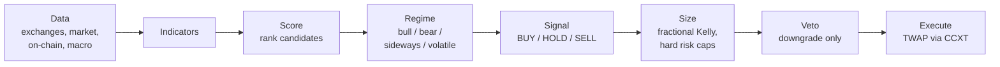

# Elite Swing Trader

A deterministic crypto swing-trading system: market data in, ranked and risk-sized trade
decisions out, with TWAP execution through CCXT. Built in Python with a Flask dashboard,
1,250 tests, and a pre-registered trial process that holds every strategy to gates fixed
before the backtest runs.

> **Status: paper trading only. No proven edge yet.** Live execution is off. The system's
> own honest re-tests rejected the original strategy, and nothing has yet passed the
> pre-registered gates. That result is documented in the open (see
> [How strategies get tested](#how-strategies-get-tested)), because a system that can say
> "this doesn't work" is more useful than one that can't.

---

## The pipeline

Every signal flows through one deterministic path. The same code runs live, on paper, and
in historical replay; backtests don't get a separate, friendlier implementation.



| Stage | Module | What it does |
|---|---|---|
| Data | `enhanced_data_fetcher.py`, `onchain_data.py`, `resilient_http.py` | Pulls from about a dozen sources (exchanges via CCXT, CoinGecko with fallbacks, macro, sentiment, on-chain), with retries and circuit breakers |
| Indicators | `indicators.py` | Technical features computed on cached OHLCV |
| Score | `scorer.py`, `quant_signal.py` | Ranks candidates by a deterministic quant score |
| Regime | `market_regime.py`, `risk_regime.py` | Classifies the market; regime shifts the thresholds |
| Signal | `quant_signal.py`, `thresholds.py` | Turns scores into actions against centralized thresholds |
| Size | `position_sizer.py` | Risk-based sizing, fractional Kelly, volatility scaling, hard caps |
| Veto | `veto_specialist.py` | Nine failure-mode rules that can only turn a BUY into a HOLD |
| Execute | `execution_engine.py`, `reconciliation.py` | TWAP order slicing, fill tracking, exchange reconciliation |

---

## Key design decisions

**Deterministic signals, no randomness.** Scoring and ranking produce the same output for
the same input, so every decision can be audited and replayed exactly.

**The veto can only downgrade.** The veto layer sits after signal generation and can turn
a BUY into a HOLD. It can never create or upgrade a trade. That asymmetry is what made it
safe to put an LLM in that seat originally. The current veto is nine deterministic rules
(extreme funding, whale outflows, long-term-holder distribution, euphoria and
extended-rally checks), so its behaviour is now fully reproducible as well.

**Sizing is Kelly-informed and capped.** Base size comes from a fixed fraction of capital
at risk divided by the stop distance. A quarter-Kelly multiplier, scaled by estimated
edge, adjusts that, and volatility scaling shrinks it further. Hard caps sit on top of
all of that: a per-position cap, a cash-usage cap, and a total-portfolio-risk ceiling
(6% for larger accounts) that auto-execution cannot exceed.

**TWAP execution.** Orders are split into 4–6 tranches over a 30–60 minute window to
reduce market impact. Fills that fail to journal are queued and retried, and positions
are reconciled against the exchange.

**Fail-closed execution.** Live trading is on only if the config explicitly says `true`.
A missing, corrupt, or null config means off. Regression tests pin that behaviour.

**JSON files for state.** Positions, configs, and audit trails are plain JSON/JSONL files
with atomic writes and file locks (`safe_json.py`, `execution_config_file_lock.py`). For a
single-operator system this is easy to inspect, diff, and back up, and needs no database
server.

**Costs are modelled from real fills.** `fill_cost_model.py` is the single source of truth
for fees and slippage, calibrated to measured exchange fills. Paper and backtest results
pay the same costs a live trade would.

---

## Testing

1,250 tests, organized by type rather than by module:

| Directory | Covers |
|---|---|
| `tests/unit/` | Signal generation, sizing, regime, veto rules, thresholds |
| `tests/integration/` | API routes, backtester, trade journal, data fetching |
| `tests/execution/` | TWAP, order tracking, reconciliation (all exchange calls mocked) |
| `tests/stress/` | Buy-signal stress and edge cases |

`app.py` creates global singletons and locks on import, so `tests/conftest.py` gives
every mutable global an autouse isolation fixture, and imports the Flask app lazily only
for the tests that need it. The suite runs in parallel under pytest-xdist and never
touches real state files.

```bash
python -m pytest tests/ -q          # full suite
python -m pytest tests/unit/ -x -q  # fast feedback
```

---

## How strategies get tested

Backtests are easy to fool, so strategy evaluation follows a **pre-registered trial
process**:

1. **Register before running.** Each trial's hypothesis, pass/fail gates, and kill
   conditions are written to `data/trials.jsonl` (append-only) and committed *before* the
   test runs. A result row is appended afterwards. Nothing gets re-graded silently.
2. **Fixed gates.** Out-of-sample performance, bootstrap lower bound, robustness to
   removing the best trades, walk-forward folds, and a benchmark the candidate has to
   beat. The full gate set lives in [`STRATEGY.md`](STRATEGY.md).
3. **Honest inputs.** A point-in-time universe (`pit_universe.py`) that includes coins
   that later died or were delisted, and measured fees in place of optimistic ones.
4. **A quarterly trial budget**, to limit how many shots a strategy gets at the same data.

So far this process has **rejected every candidate**, including the original strategy. Its
headline backtest edge came from survivorship bias, and it failed once re-run on an honest
universe. Each trial and its lesson is written up in plain language in
[`docs/TRIAL_HISTORY.md`](docs/TRIAL_HISTORY.md). The artifacts behind each verdict are
in `data/`.

[`STRATEGY.md`](STRATEGY.md) is the operating record: decisions in force, gates, the
promotion ladder from paper to live, and a dated decision log.

---

## Quickstart

Requires Python 3.12+ (developed on 3.14).

```bash
# with uv (reproducible, from uv.lock)
uv sync --all-groups

# or with pip (pinned versions + hashes)
pip install -r requirements.txt

cp .env.example .env   # add your API keys; most data sources have free tiers
python app.py          # dashboard at http://localhost:5000
```

Live execution is off by default and stays off unless you explicitly enable it in
`execution_config.json`. Exchange keys are optional. If you add them, give them read and
trade permissions only, never withdrawal.

Other entry points:

- `scheduler_manager.py`: scheduled data refresh
- `historical_replay.py`: accelerated backtesting through the live pipeline

---

## Disclaimer

This is a personal research project, not financial advice. It has no demonstrated edge.
Don't trade real money with it on the assumption that it works.

## License

[MIT](LICENSE)
