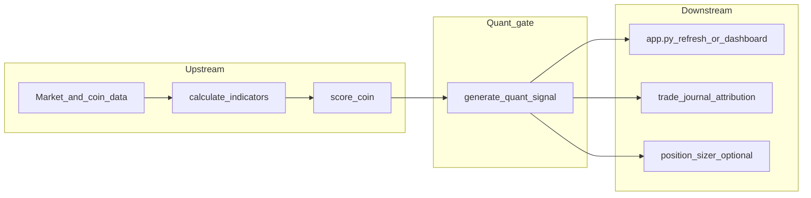
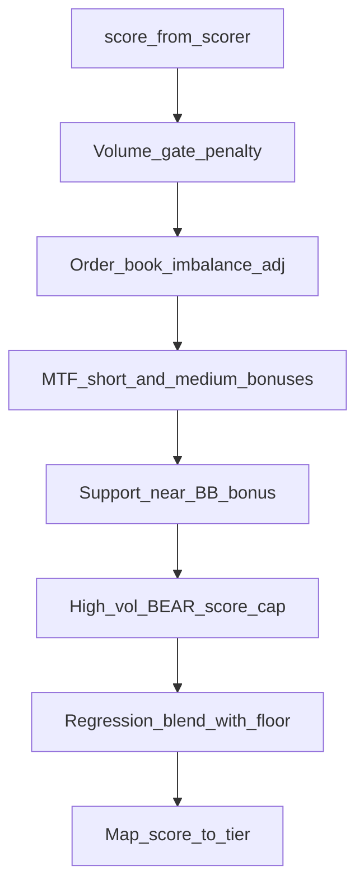
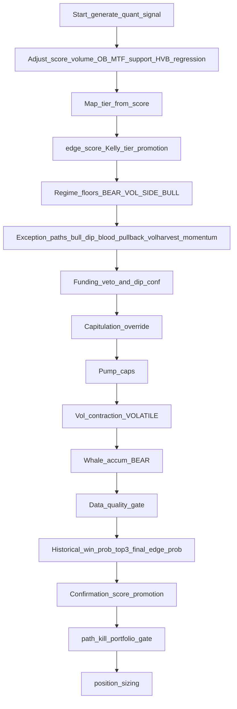

# Quant gate: components, scoring, and flows

Reference for the deterministic quant layer and upstream scoring. Implementation: [`quant_signal.py`](../quant_signal.py) (`generate_quant_signal`), [`scorer.py`](../scorer.py) (`score_coin`), thresholds via [`thresholds.py`](../thresholds.py) and `live_thresholds.json`.

**Design rule (from `quant_signal.py`):** the LLM may only veto or explain; `generate_quant_signal` is the primary signal engine.

---

## End-to-end pipeline

---

## A. Upstream: base score (feeds the gate)

**Function:** `score_coin(coin, fg_value, news_score, market_24h_pct)` in [`scorer.py`](../scorer.py).

| Component | Role | How it affects 0–100 |
| --- | --- | --- |
| **RSI** | Mean-reversion vs trend mode | Up to 25 pts (`_rsi_score` or `_rsi_score_momentum` if *momentum context*) |
| **Momentum** | Strength of trend | Up to 25 pts (`_momentum_score`) |
| **Volume** | Turnover vs market cap | Up to 15 pts (`_volume_score`) |
| **Sentiment** | Fear & Greed + news | Up to 20 pts (`_sentiment_score`) |
| **Bollinger position** | Band location | Up to 15 pts (`_bb_score` or `_bb_score_momentum`) |
| **MACD** | Confirmation | ±3 (`_macd_bonus`) |
| **Momentum context flag** | Switches RSI/BB to trend-following curves | When acceleration + positive multi-TF moves (not a pump) |
| **Contextual bonuses/penalties** | Rally, dip, pullback, bull participation, etc. | Clamped adjustments (e.g. rally +4, blood-in-street +5, short-term overbought −2) |

Output is merged into the coin as `score`, `signal` (BUY/HOLD/SELL from `_generate_signal`), `breakdown`, and **`risk`** (`rr_ratio`, `stop_loss_pct`, etc.). The quant gate reuses **`score`** and **`risk`** heavily.

---

## B. Quant gate: score evolution inside `generate_quant_signal`

Starting value: `score = float(coin.get('score', 0))`.

Positive boosts share a **cumulative cap** `MAX_CUMULATIVE_ADJ` (default 15) via `_apply_adj` — **negative adjustments are not capped**.

| Step | What it does | Primary inputs |
| --- | --- | --- |
| **Volume gate** | If coin volume &lt; `volume_median * VOLUME_GATE_RATIO`, subtract `VOLUME_GATE_PENALTY` | `coin.total_volume`, `regime_data.volume_median` |
| **Order book imbalance** | `bid_ask_ratio` vs 1.0 → bounded adj ±`OB_IMBALANCE_MAX_ADJ` | `coin.enhanced.order_book` |
| **MTF alignment (short)** | Bonus if 1h/24h/7d same sign | `coin_utils.get_price_changes` |
| **MTF alignment (medium)** | Extra bonus if 24h/7d/30d same sign | Same |
| **Support-near bonus** | Low `bb_pos` → small boost (`SUPPORT_NEAR_BONUS` etc.) | `coin.indicators.bb_pos` |
| **High-vol BEAR cap** | If `BEAR` and `atr_pct >= HIGH_ATR_PCT` and score &lt; `HIGH_ATR_BEAR_MIN_SCORE`, force score ≤ 77 | `regime`, `atr_pct` |
| **Regression blend** | Mixes score with `get_regression_score` probability × 100, weight `REGRESSION_SCORE_WEIGHT`; cannot drag below `REGRESSION_MAX_DRAG_PCT` of pre-blend score | [`regression_scorer.py`](../regression_scorer.py) |

The **numeric score** after these steps is what most regime floors and paths compare against, unless later steps only change **signal/tier** (e.g. path overrides).

---

## C. Tier mapping from score (first BUY/HOLD decision)

After adjustments + regression:

| Condition | `quant_signal` | `quant_tier` | `quant_confidence` (initial) |
| --- | --- | --- | --- |
| score ≥ 85 | BUY | ULTRA_BUY | 92 |
| score ≥ 72 | BUY | STRONG_BUY | 78 |
| score ≥ 58 | BUY | MODERATE_BUY | 65 |
| else | HOLD | HOLD | 50 |

---

## D. Edge metrics (separate from the 0–100 score)

Two related quantities:

1. **`edge_score`** — fractional Kelly using **estimated** win prob (`_estimated_win_prob`: regime base + optional SOPR bump), **only if** `risk.rr_ratio > 0` and `risk.stop_loss` is present (see code). Used mainly for **tier promotion** when `edge_score` crosses `EDGE_BOOST_THRESHOLD` and sub-thresholds for MODERATE→STRONG and STRONG→ULTRA.

2. **`final_edge_prob`** — same Kelly form but uses **`historical_win_prob`** from `get_historical_win_prob` (cached) for **top-3** coins; otherwise falls back to estimated path. Passed to **`position_sizer.calculate_for_consensus`** as `edge_probability` when a sizer is supplied.

---

## E. Regime safety floors (can force HOLD after tier map)

Applied in order after tier mapping (and edge-based tier bumps):

| Regime | Rule | Effect |
| --- | --- | --- |
| **BEAR / VOLATILE** | `score < regime_floor` → HOLD | `regime_floor` = 72 if `market_24h_pct > 5` else `BEAR_REGIME_MIN_SCORE` |
| **SIDEWAYS** | `score < SIDEWAYS_REGIME_MIN_SCORE` → HOLD | Stricter sideways entries |
| **BULL** | `score < BULL_REGIME_MIN_SCORE` → HOLD | Low-score bull entries blocked |

---

## F. Exception paths

Many paths upgrade **HOLD → BUY** only when `quant_signal == 'HOLD'` before that block (e.g. blood, dip, pullback, vol harvest, momentum). **Bull participant** is a BULL-specific exception after the bull floor. **Capitulation** runs after the funding veto and only fires when funding is not elevated. **Vol contraction** refines an existing BUY under VOLATILE. **Whale accum** can add score and sometimes flip HOLD→BUY.

**Path attribution** priority in `_resolve_quant_path`: blood → capitulation → momentum_breakout → early_momentum → dip → pullback → vol_harvest → vol_contraction → bull_participant → rally → default.

| Path | Regime / gate | Idea |
| --- | --- | --- |
| **Bull participant** | BULL, was HOLD but score ≥ bull floor | MTF medium aligned + `momentum > 10` |
| **Blood in the street** | BEAR/VOLATILE, F&G &lt; `BLOOD_STREET_FG`, score ≥ min | Sharp 24h down + 1h stabilizing + 7d not freefall |
| **Dip** | BEAR/VOLATILE, F&G ≤ `BLOOD_FG_MAX`, score ≥ `DIP_MIN_SCORE` | Deeper dip + stabilizing 1h |
| **Pullback in trend** | BEAR/VOLATILE, F&G ≤ `PULLBACK_FG_MAX` | 7d/30d up, 24h mild red band |
| **Volatility harvest** | BEAR/VOLATILE, high ATR, fear band | Red 24h, stabilizing 1h, 7d floor |
| **Momentum breakout** | Any regime if still HOLD | Score/momentum/accel/quality/MTF/RSI/24h–7d caps; STRONG vs MODERATE by quality + relative strength |
| **Early momentum** | Any regime if still HOLD | Lower bar than breakout; **higher min score in SIDEWAYS** |

**Funding veto (BEAR):** if `funding_pct > FUNDING_VETO_BEAR_PCT` → **HOLD**. **Capitulation** BUY in BEAR requires funding not elevated (`funding_pct is None or funding_pct <= veto threshold`), so it does not override an active funding veto.

**Negative funding on dip path:** bumps `quant_confidence` when the dip path is taken.

---

## G. Post-BUY refinements (tier/confidence; not always score)

| Component | Effect |
| --- | --- |
| **Pump caution** | If not BULL, extended 24h/7d/30d moves **cap** ULTRA→STRONG or STRONG→MODERATE |
| **VOLATILE contraction** | VOLATILE + high ATR + medium MTF aligned + funding OK → bump toward STRONG_BUY band |
| **Light whale accum (BEAR, top-10)** | Can add +3 to score (capped) and optionally flip HOLD→MODERATE_BUY if score ≥ 58 |
| **Data quality gate** | STRONG/ULTRA need `enhanced.data_quality.ok_count ≥ REQUIRED_SOURCES_FOR_STRONG_BUY`; else downgrade + confidence trim |
| **Confirmation score** | `score * CONF_SCORE_BASE_WEIGHT` + bonuses (sniper active, whale badge), capped; can promote MODERATE→STRONG for **top-3** if confirmation is high and base score ≥ `CONF_PROMOTE_MIN_SCORE` |

---

## H. Final kill switches (top-3 scoped where noted)

| Gate | Behavior |
| --- | --- |
| **Path kill** | If `quant_path != 'default'` and journal stats show poor win rate **and** negative expectancy over `PATH_KILL_MIN_TRADES` → **HOLD** + badge |
| **Portfolio gate** | **Top-3** BUY only: max open per regime / total open → **HOLD** |

---

## I. Outputs (signal generation)

`generate_quant_signal` returns a dict including:

- `quant_signal`, `quant_tier`, `quant_confidence`
- `score` (final adjusted numeric score)
- `edge_score`, `edge_probability` (top-3 historical edge), `historical_win_prob` (top-3)
- `quant_path`, `signal_badges`, `reasoning`
- `confirmation_score`, `short_tf_sniper` / light sniper payload
- `position_sizing` (if `position_sizer` is passed)

**Wiring:** [`app.py`](../app.py) calls `generate_quant_signal` during refresh (optional `position_sizer` / cash); [`historical_replay.py`](../historical_replay.py) runs the same pipeline for attribution.

---

## J. Detailed internal flow (decision order)

---

## Summary

- **Scoring a position** = multi-factor **0–100 base** ([`scorer.py`](../scorer.py)) plus microstructure and timeframe adjustments, **regression blend**, **threshold tiers**, **regime floors**, **named exception paths**, **risk/funding/data-quality/pump** rules, **kill switches**, and optional **Kelly-driven sizing** ([`quant_signal.py`](../quant_signal.py)).
- **`quant_tier`** is the primary discrete label for consensus and UI; **`quant_confidence`** and **`confirmation_score`** add execution polish; **`quant_path`** + **`signal_badges`** record *why* the signal fired for attribution and the recursive optimizer.
